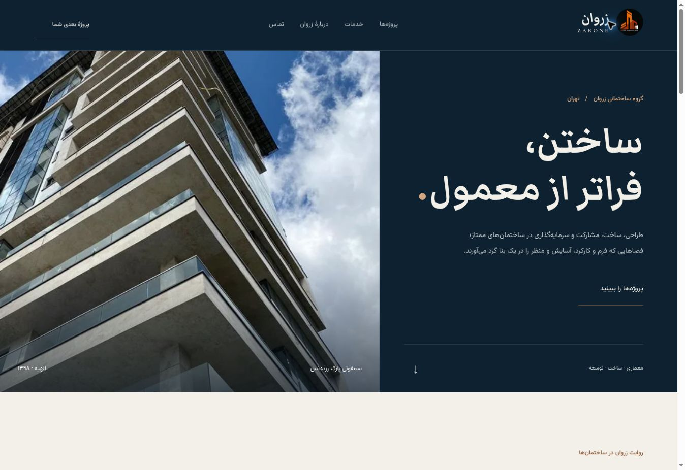
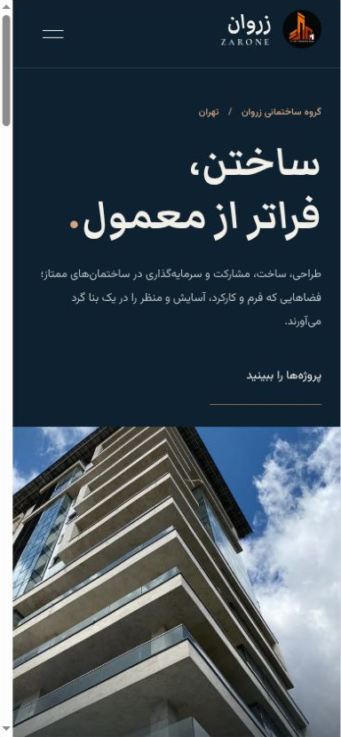

# Zarone website proposal

The Instagram reference was inspected on 11 November 2026: the original copper architectural mark on a dark background, real construction, interior and project imagery, and the architecture/engineering/construction/development description.

The proposal retains that original mark, the repository's navy family and project photographs. A limestone background and restrained copper accents frame a photo-led Persian portfolio. No project, floor-area, date, contact number or testimonial was invented.

The images show a local preview. They are not evidence of a live zarone.ir deployment. The phone capture comes from a 390 × 844 layout frame; the desktop layout was also checked at 1366 × 860.
