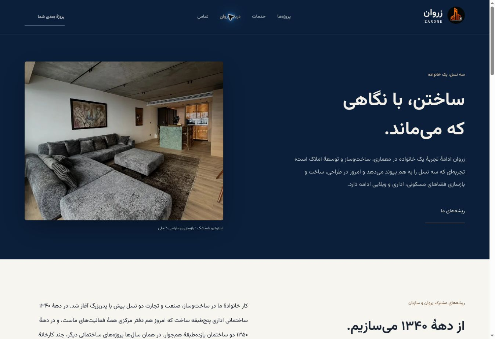
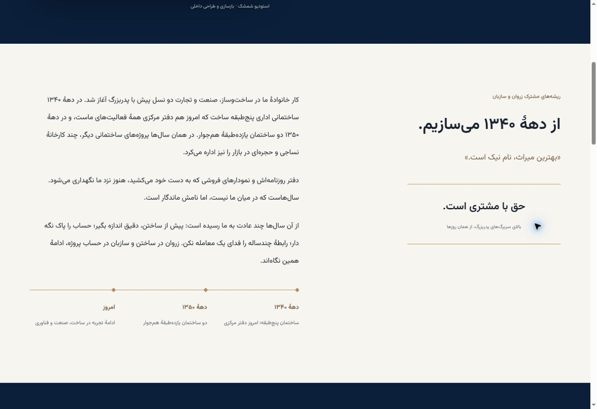
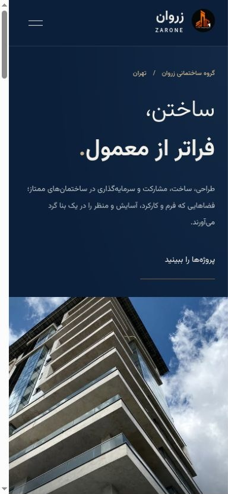
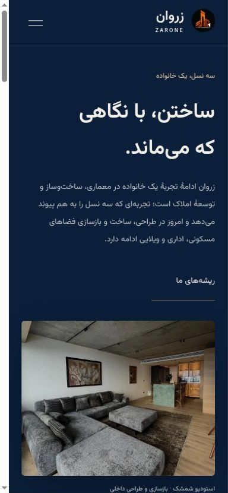
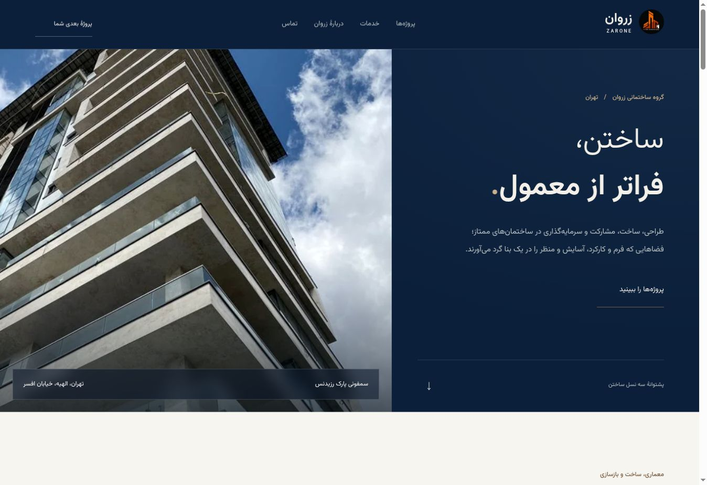
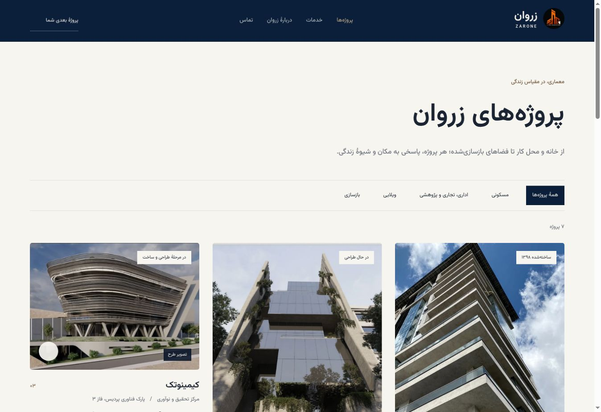
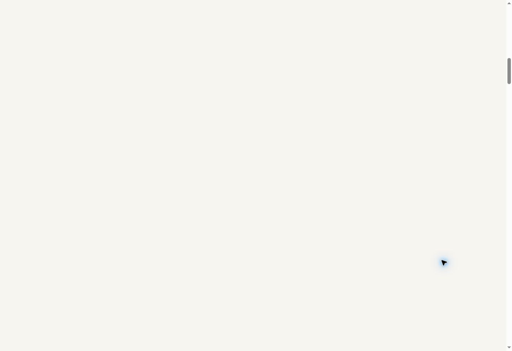
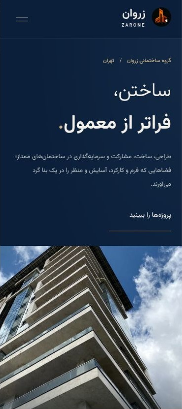

# Zarone — Symphony-led portfolio and aligned brand

Vazirmatn is used for every text role. The main palette follows Sazban's current navy/stone website, with KCZ's shared clean typography, restrained accents and photo-led hierarchy. The original Instagram architectural mark remains subtle and replaceable. Seven existing project records are retained; the Ramsar landscape feature labels its render.

About Us uses Sazban's current three-generation family history, the exact «دفتر مرکزی همهٔ فعالیت‌های ماست» wording, the grandfather's sayings and the same authentic heritage-building photographs. It explains the construction experience behind Sazban and links the separate specialist work of Zarone, Sazban and Kimia Ceram Zarin. See [source/provenance notes](../BRAND_ALIGNMENT.md).

The captures show the local review build. Rendering was checked in 390 × 844 phone and 1366 × 860 desktop frames; the capture service scales screenshot pixels. No horizontal overflow or site JavaScript errors were observed. The older `desktop.png` and `mobile.png` remain as the preceding proposal's captures.

The production domain has not been updated. This proposal remains in the same draft PR, preserving the visual-approval gate and the previously documented hosting/DNS blocker.

## Instagram portfolio update

The Symphony Park Residence photograph is the homepage hero and links to its full project page. All seven documented projects now appear on the homepage. The galleries contain 31 captioned images, including 17 Symphony photographs. Verified Instagram posts and location tags are linked on project pages; render and construction images are explicitly labelled. Two additional Lavasan highlights appear as source links, pending access to the login-only images. No project facts were inferred from unrelated comments. See [Instagram audit](../INSTAGRAM_AUDIT.md).

Current checks: 390 × 844 phone homepage and project, 1366 × 860 archive, zero horizontal overflow, project category filters (7 total / 2 renovations), and captioned lightbox navigation. The phone screenshot is cropped to the phone frame; the service scales screenshot pixels. Site errors were absent from the captured error log (browser extension metadata warnings are unrelated to the site).
